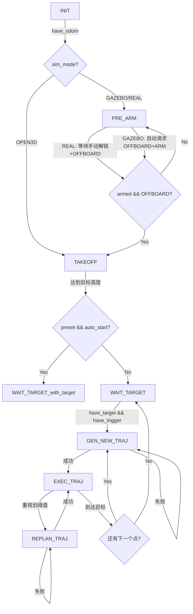

# EGOReplanFSM 状态机起飞逻辑分析

## 状态流程图



---

## 三种仿真模式对比

| 模式 | sim_mode | 解锁方式 | OFFBOARD切换 | 适用场景 |
|:---|:---|:---|:---|:---|
| **GAZEBO** | 0 | 自动调用arming service | 自动调用set_mode service | PX4 SITL仿真 |
| **OPEN3D** | 1 | 无需解锁 | 跳过PRE_ARM | 纯Open3D可视化 |
| **REAL** | 2 | **手动遥控器解锁** | **手动遥控器切OFFBOARD** | 真实飞行 |

---

## 当前实物模式(REAL)逻辑

位置: `ego_replan_fsm.cpp` 第166-206行

```cpp
case PRE_ARM:
{
  if (sim_mode_ == SIM_REAL)
  {
    // 1. 等待FCU连接
    if (!current_state_.connected) { ... }
    
    // 2. 持续发布悬停指令（保持setpoint活跃）
    publishHoverCmd();
    
    // 3. 等待飞手手动解锁+切OFFBOARD
    if (current_state_.mode == "OFFBOARD" && current_state_.armed)
    {
      // 检测到已解锁+OFFBOARD，进入TAKEOFF
      changeFSMExecState(TAKEOFF, "FSM");
    }
  }
}
```

### ✅ 当前逻辑正确性

1. **等待FCU连接** - 正确
2. **持续发送setpoint** - 正确（PX4要求进入OFFBOARD前有setpoint）
3. **等待手动操作** - 正确（不主动调用arming/set_mode service）
4. **检测条件** - `mode == "OFFBOARD" && armed`

### ⚠️ 潜在问题

1. **启动时setpoint频率**：`publishHoverCmd()` 只在PRE_ARM回调中调用（10Hz），而PX4要求至少2Hz
2. **hover_pos_未初始化**：在PRE_ARM阶段，`hover_pos_`可能未正确设置

---

## 建议的实物飞行流程

### 用户操作流程

1. **启动节点** → INIT (等待里程计)
2. **里程计到达** → PRE_ARM (节点等待)
3. **遥控器拨杆解锁** → 节点检测到armed
4. **遥控器切OFFBOARD** → 节点检测到OFFBOARD模式
5. **自动起飞** → TAKEOFF
6. **达到高度** → WAIT_TARGET → 开始规划

### 安全建议

在REAL模式下，建议在用户切OFFBOARD后增加延迟确认，避免误触发：

```cpp
if (current_state_.mode == "OFFBOARD" && current_state_.armed)
{
  static ros::Time offboard_detected_time = ros::Time(0);
  if (offboard_detected_time.isZero())
  {
    offboard_detected_time = ros::Time::now();
    ROS_INFO("[EGOReplanFSM] REAL mode: OFFBOARD detected, waiting 2s for confirmation...");
  }
  else if ((ros::Time::now() - offboard_detected_time).toSec() > 2.0)
  {
    // 2秒稳定后才进入TAKEOFF
    changeFSMExecState(TAKEOFF, "FSM");
  }
}
```

---

## 参数配置说明

在 `planner_test.yaml` 中设置：

```yaml
fsm:
  sim_mode: 2     # 0=GAZEBO, 1=OPEN3D, 2=REAL
  takeoff_height: 1.5
  auto_start_preset: true
```

