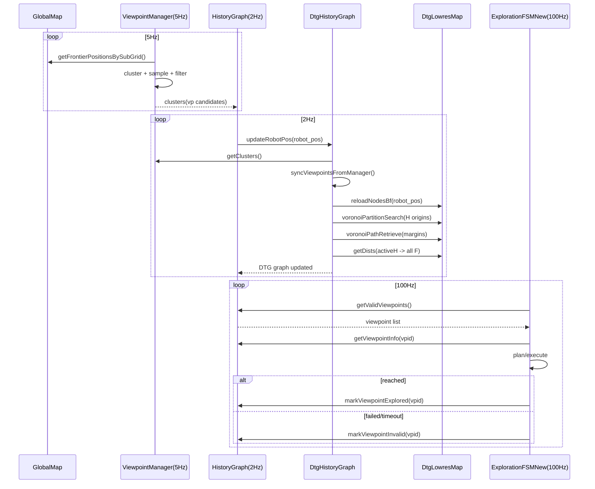
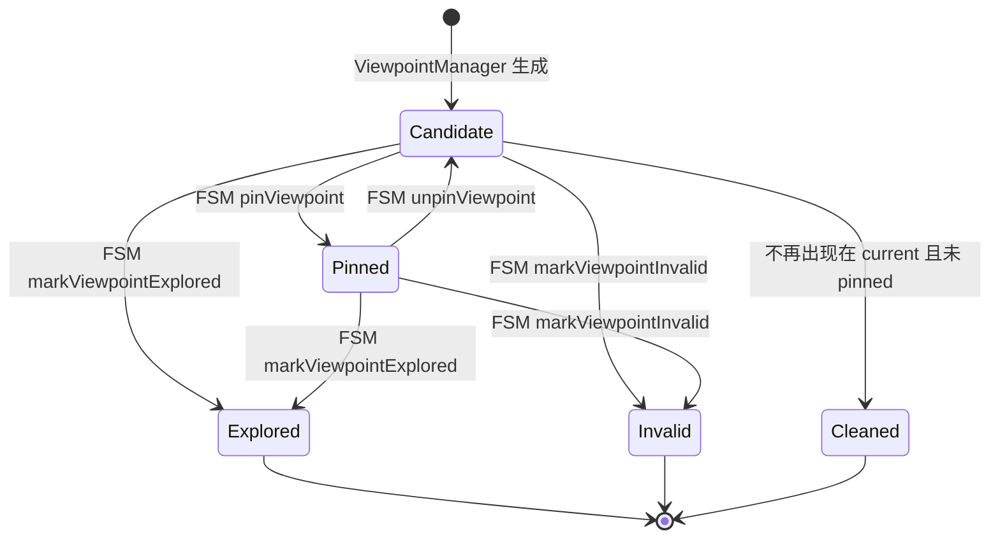

# DTG（Dynamic Topological Graph）在 STAR-Searcher 新架构中的实现说明

本文档面向 `STAR-Searcher` 新架构中的 **DTG 历史图（HistoryGraph / DTG mode）实现**，目标是把“代码里到底实现了什么、为什么这么做、怎么运行、在系统里怎么被调用”讲清楚。

文档覆盖：
- DTG 在本项目中的**架构定位与数据流**
- 关键**数据结构**（H/F/Edge/LowResMap 等）
- 关键**算法原理与流程**（低分辨率可达性、Voronoi 分区、H-H/H-F 边构建、视点生命周期）
- **线程/同步设计**与注意事项
- 在探索项目中的**调用点**（谁调用谁，频率多少）
- 关键**参数**说明（与 `exploration_new.yaml` 对应）
- 调试建议

> 代码位置索引（本实现主要涉及）：
> - `include/rog_map/dtg_history_graph.h`
> - `src/rog_map/dtg_history_graph.cpp`
> - `include/rog_map/dtg_lowres_map.h`
> - `src/rog_map/dtg_lowres_map.cpp`
> - `src/rog_map/history_graph.cpp`（DTG 模式适配层）
> - `src/rog_map/viewpoint_manager.cpp`（视点生成）
> - `src/rog_map/exploration_fsm_new.cpp`（状态机选点/执行/标记）

---

## 1. 为什么要有 DTG：本项目中的问题与目标

在探索任务里，系统需要持续产生候选视点（Viewpoints / Frontiers），并在这些候选视点之间做选择与规划。传统做法往往在每次选点时调用昂贵的全局 A*/ESDF/优化等。

本项目的 DTG 设计目标可以概括为：

1. **把“全局可达性/连通关系”从高频规划中剥离出来**
   - 状态机（FSM）100Hz，不可能每次决策都做重型全局搜索。
   - DTG 在较低频率（本项目是 2Hz）维护一个拓扑层图结构，作为“全局结构化记忆”。

2. **用低分辨率地图近似表达可通行空间**
   - DTG 不直接在 `GlobalMap` 高分辨率体素上做全局搜索，而是构建 `DtgLowresMap`（低分辨率栅格）。
   - 低分辨率层只关心几何三态（free/unknown/occupied），避免和高层标记（visited/frontier 等）耦合。

3. **为探索提供“历史节点（HNode）—视点（FNode）”的双层图结构**
   - HNode 表示机器人历史轨迹/关键位置的抽象锚点。
   - FNode 表示当前可探索的候选视点。
   - 通过 H-H、H-F 边来维护拓扑连通与代价。

---

## 2. 总体架构：DTG 在新探索系统中的位置

新架构日志中已经说明各模块频率（也可从代码/参数看到）：

- `MapManager`：在 lidarCallback 中同步更新（~10Hz）
- `ViewpointManager`：定时生成视点（默认 5Hz）
- `HistoryGraph`：定时维护 DTG 历史图（默认 2Hz）
- `ExplorationFSMNew`：状态机决策与调用规划（100Hz）

### 2.1 架构/调用关系图（Mermaid）

```mermaid
flowchart LR
  subgraph M[Mapping]
    MM[MapManager\n(lidarCallback ~10Hz)]
    GM[GlobalMap]
    MM --> GM
  end

  subgraph E[Exploration]
    VPM[ViewpointManager\n(5Hz)]
    HG[HistoryGraph\n(DTG mode, 2Hz)]
    DTG[DtgHistoryGraph\n(bfUpdate)]
    LRM[DtgLowresMap\n(Dijkstra/Voronoi)]
    FSM[ExplorationFSMNew\n(100Hz)]

    GM --> VPM
    VPM -->|clusters / viewpoints| HG
    HG --> DTG
    DTG --> LRM
    FSM -->|getValidViewpoints/getViewpointInfo| HG
    FSM -->|markExplored/markInvalid/pin| HG
  end
```

---

## 3. DTG 的核心数据结构（快速回顾）

- **HNode（History Node）**：稀疏历史锚点，构成拓扑骨架。
- **FNode（Frontier/Viewpoint Node）**：候选视点，来自 ViewpointManager。
- **DtgEdge**：边（同时保存代价与离散路径）。
- **DtgLowresMap**：低分辨率几何层，提供 Dijkstra/Voronoi 的距离与路径。

详见：
- `include/rog_map/dtg_history_graph.h`
- `include/rog_map/dtg_lowres_map.h`

---

## 4. 总体运行机理（端到端）：系统在跑的时候“数据如何流动”

可以把系统理解成三条并行“时间线”（不同频率），共同驱动探索：

- **5Hz：ViewpointManager**
  - 从 GlobalMap 读取当前 frontier
  - 聚类、采样、过滤
  - 输出 clusters（每个 cluster 附带 best viewpoint：pos/yaw/score）

- **2Hz：HistoryGraph/DTG**
  - 同步 ViewpointManager 的 clusters 到 DTG（生成/更新/清理 FNode）
  - 以 robot_pos 为中心刷新 lowres block
  - 维护 HNode，构建 H-H、H-F 边

- **100Hz：FSM**
  - 从 HistoryGraph 取有效 viewpoints 列表
  - 选点、规划、执行
  - 到达/失败后标记 explored/invalid

### 4.1 端到端时序图（Mermaid）



> 注意：这张时序图也说明了为什么需要锁/同步：DTG 维护与 FSM 查询会在不同线程/回调中同时发生。

---

## 5. DTG 每次更新（bfUpdate）到底做了什么

DTG 的核心更新函数是 `DtgHistoryGraph::bfUpdate(robot_pos)`，可以把它理解为：

- **先把“当前候选视点”变成 FNodes**
- **再把“当前位置附近的几何空间”压缩成 lowres block**
- **然后在 lowres block 上维护拓扑骨架（H-H）与当前位置到视点的连接（H-F）**

### 5.1 bfUpdate 总流程图（Mermaid）

```mermaid
flowchart TD
  A[bfUpdate(robot_pos)] --> B[syncViewpointsFromManager\n同步/更新/清理 FNodes]
  B --> C[lrm.reloadNodesBf\n构建局部 lowres block]
  C --> D{root_ 是否存在?}
  D -- 否 --> D1[createHnode(robot_pos)\nroot_=active]
  D -- 是 --> E[在 h_list_ 中找最近 HNode]
  E --> F{距离 > h_thresh ?}
  F -- 是 --> F1[createHnode(robot_pos)\nactive=新节点]
  F -- 否 --> F2[active=最近节点]
  D1 --> G
  F1 --> G
  F2 --> G
  G[准备 Voronoi 多源 origins\n(所有 HNode)] --> H[lrm.voronoiPartitionSearch\n多源 Dijkstra + margins]
  H --> I[lrm.voronoiPathRetrieve\n从 margins 回溯恢复 H-H 路径]
  I --> J[connectHH\n更新/建立 H-H 边]
  J --> K[收集所有 FNode 位置]
  K --> L[lrm.getDists(activeH -> all F)\n单源 Dijkstra]
  L --> M[connectHF\n更新/建立 activeH-F 边]
  M --> Z[bfUpdate end]
```

### 5.2 视点生命周期状态机（Mermaid）



---

## 6. 核心算法 1：LowResMap 的可通行判定（free/unknown/occupied）

DTG 的所有搜索都发生在 `DtgLowresMap` 上，它把高分辨率 GlobalMap 压缩成一个低分辨率网格。

### 6.1 从 GlobalMap 到 lowres cell 的“采样统计”

对应函数：`DtgLowresMap::computeNodeOccupancy(node_id3, node)`

- 一个 lowres cell 的空间大小为：`resolution x resolution x resolution`
- 在这个 cell 内，按 `occ_sample_resolution` 做网格采样
- 对每个采样点调用 `getVoxelStateLite()`：
  - occupied -> 认为这个采样点不可通行
  - free -> 计入 `free_num`
  - unknown -> 计入 `unknown_num`

### 6.2 可通行性（Feasible）判定规则

对应 `DtgLowresMap::getDists()` 内部的 lambda：

- 如果 `free_num > 0`：可通行
- 否则如果 `allow_unknown == true` 且 `unknown_num > 0`：可通行
- 否则：不可通行

直觉：
- 只要 cell 内存在一点 free，就认为能穿过去（偏乐观）。
- 若允许 unknown，则探索会更激进（unknown 也能走）。

---

## 7. 核心算法 2：H-F 路径计算（getDists 单源 Dijkstra）

接口：`DtgLowresMap::getDists(origin, targets[], dist[], paths[])`

### 7.1 getDists 内部流程图（Mermaid）

```mermaid
flowchart TD
  A[getDists(origin, targets)] --> B[posToId3(origin)->start_id3]
  B --> C[id3ToIndex(start_id3)->start_idx]
  C --> D{start cell feasible?}
  D -- 否 --> X[return: all dist=INF]
  D -- 是 --> E[初始化优先队列 pq\n g(start)=0]
  E --> F[循环: pop 最小 g 的节点 cur]
  F --> G[对 26 邻居扩展]
  G --> H{neighbor feasible?}
  H -- 否 --> G
  H -- 是 --> I[若 new_g < g_cost[nei]\n则更新 parent[nei]=cur]
  I --> G
  F --> J{是否覆盖所有 targets?}
  J -- 否 --> F
  J -- 是 --> K[对每个 target 回溯 parent[]\n得到路径点序列]
  K --> Z[return dist + paths]
```

### 7.2 路径恢复（parent 回溯）

- Dijkstra 运行时维护 `parent[nei] = cur`（存索引）
- 对每个 target_idx：从 target 一直沿 parent 回溯到 start
- 将回溯得到的索引序列转换为坐标 `id3ToPos()`
- 反转顺序得到 start->target 的路径

在 DTG 中的用途：
- `bfUpdate` 里用于 activeH -> all F 的 `hf_paths`，并通过 `connectHF` 存到 `DtgEdge::path`。

---

## 8. 核心算法 3：Voronoi 分区（多源 Dijkstra）如何构建 H-H 边

这里是 DTG 的最核心点：不用对每对 HNode 都跑一次最短路，而是用一次多源传播来得到“可能相连的 H-H 关系”。

### 8.1 Voronoi 分区要解决的问题

给定多个 HNode（历史锚点），我们想知道：

- 哪些 HNode 在当前可通行空间里可能互相连通（并能恢复一条路径）？
- 如何在较低频率下（2Hz）快速维护这种连通关系？

方法：
- 把所有 HNode 当作“种子点”（origins），在 lowres block 内做多源 Dijkstra。
- 每个 lowres cell 被离它最近（最小 path_g）的那个 HNode “占领”。
- 当不同 HNode 的占领区域相遇，就产生边界（margins）。
- 在边界处向两侧回溯到各自 root，就得到一条连接两 HNode 的路径。

### 8.2 voronoiPartitionSearch 内部流程（Mermaid）

对应函数：`DtgLowresMap::voronoiPartitionSearch(search_origins, margins)`

```mermaid
flowchart TD
  A[输入: search_origins = (root_id, pos)] --> B[对 block 内每个 LRNode 清零]\
  B --> C[将每个 origin 映射到 idx]\
  C --> D[对 origin idx 设定]\
  D --> E[path_g=0, root_id=origin_id, parent_dir=13]\
  E --> F[push 到 pq(g, idx, root_id)]

  F --> G[while pq 非空: pop cur]
  G --> H{cur.g > node.path_g?}
  H -- 是 --> G
  H -- 否 --> I[遍历 26 邻居 nidx]

  I --> J[计算 new_g = cur.g + edge_cost]
  J --> K{new_g < neighbor.path_g ?}
  K -- 是 --> L[更新 neighbor: path_g/root_id/parent_dir]\
  L --> M[push neighbor 到 pq]
  K -- 否 --> N{neighbor.root_id != 0 且 neighbor.root_id != cur.root ?}
  N -- 是 --> O[记录 margins: neighbor_id3]\
  O --> I
  N -- 否 --> I

  M --> G
```

### 8.3 关键变量解释（与你代码一一对应）

- `LRNode::path_g`
  - 表示该 cell 到其所属 root(HNode) 的最短距离
  - 多源 Dijkstra 的核心“代价”变量

- `LRNode::root_id`
  - 表示该 cell 目前被哪个 root(HNode) 占领
  - 最终形成 Voronoi 分区：同一 root_id 的 cell 构成一个区域

- `LRNode::parent_dir`
  - 传播时记录方向 d（0~26）
  - 用于后续 `retrieveHPath()` 从任意 cell 沿 parent_dir 回溯到 root

- `margins`
  - 记录 Voronoi 区域的交界位置（粗略意义上的“分界线 cell”）
  - 后续在 `voronoiPathRetrieve()` 中用于生成 H-H 边

### 8.4 `parent_dir` 为什么能回溯到 root：方向编号的约定

代码中的方向列表 `connect_diff_` 是按 3x3x3 枚举得到的 27 个偏移（含 0,0,0）。

- `parent_dir == 13` 被定义为 self（不再向上回溯）
- 若当前 cell 的 `parent_dir = d`，代表它是从某个父 cell 传播而来
- 回溯时使用 `p_dir_inv = 26 - parent_dir` 来找到反方向（这是该实现里对 27 邻接编号的一个约定）

---

## 9. 核心算法 4：H-H 路径恢复与拼接（voronoiPathRetrieve）

对应函数：`DtgLowresMap::voronoiPathRetrieve(...)`

### 9.1 H-H 连接为什么来自“margin + neighbor”

在一个 margin cell 周围，如果存在邻居 cell 属于不同 root：
- `margin_node.root_id = rootA`
- `neighbor_node.root_id = rootB`

则说明 rootA 和 rootB 的 Voronoi 区域在此相邻。

DTG 的策略是：
- 认为 rootA 与 rootB 在 lowres 空间里“可能相连”
- 用两次回溯把路径拼起来

### 9.2 路径拼接示意图（Mermaid）

```mermaid
flowchart LR
  subgraph VA[Voronoi 区域 A]
    RA[rootA (HNode)]
    A1[...]
    MA[margin cell]
    A1 --> MA
    RA --> A1
  end

  subgraph VB[Voronoi 区域 B]
    RB[rootB (HNode)]
    B1[...]
    NB[neighbor cell]
    B1 --> NB
    RB --> B1
  end

  MA --- NB
```

这里 `MA` 与 `NB` 相邻，且 root 不同。

### 9.3 `retrieveHPath` + `reverse/splice` 的原因（对应代码）

在 `voronoiPathRetrieve` 中：

- `retrieveHPath(margin_id3, path1, length, false)`
  - 得到：`margin -> ... -> rootA`（因为是沿回溯方向 push）

- `retrieveHPath(neighbor_id3, path2, length, true)`
  - `reverse_order=true` 会得到：`rootB -> ... -> neighbor`

然后：
- `path1.reverse()`：变成 `rootA -> ... -> margin`
- `path.splice(path.end(), path1)`：把 rootA 到 margin 拼到总 path
- `path.splice(path.end(), path2)`：再把 rootB 到 neighbor 拼上

最终 `path` 形状相当于：

- `rootA -> ... -> margin -> rootB -> ... -> neighbor`

它并不是严格意义的“rootA 到 rootB 的最短路径”，但在拓扑连接维护上足够：

- margin 与 neighbor 是两个 Voronoi 区域的接触点
- 分别回溯到各自 root，即可形成一条穿越接触点的连通路径

> 这就是 Voronoi 构图的本质：通过“分区边界 + 回溯”恢复区域间连接。

---

## 10. 关键参数与“机理上的影响”（补充更细）

### 10.1 `rog_map/lowres/occ_sample_resolution`

- 采样越细：
  - `free_num/unknown_num` 统计更准确
  - 但 reloadNodesBf 更慢

- 采样越粗：
  - 统计更粗糙
  - 可能把本来被障碍填满的 cell 误判为可通行（尤其在细窄障碍附近）

### 10.2 `rog_map/lowres/local_half_size_*` 与 H-H 连接的“可见范围”

- Voronoi 分区和 getDists 都只在当前 local block 内运行。
- 如果两个 HNode 相距很远或连接路径需要绕出 local block：
  - DTG 在这一帧就无法恢复到正确的 H-H 路径
  - 这会导致 H-H 边暂时缺失

因此 local_half_size 实际决定了：
- DTG 每帧能维护多大的拓扑结构

### 10.3 `allow_unknown` 对 Voronoi/margins 数量的影响

- allow_unknown=true 时，可通行 cell 增多
  - Voronoi 分区“势力范围”扩张更远
  - margins 数量可能增加（区域交界更多）

- allow_unknown=false 时，可通行 cell 减少
  - Voronoi 分区更碎
  - 很多区域可能无法接触，HH 边变少

---

## 11. 线程与同步：哪些地方最容易竞态

在实际运行中，最典型的竞态来自：

- 2Hz：DTG 更新时会修改 `f_nodes_by_vpid_`、`h_list_`、以及 H/F 的边列表
- 100Hz：FSM 会频繁调用 `getValidViewpoints()`、并可能在任意时刻调用 `markExplored/markInvalid/pin/unpin`

因此原则是：
- **所有读写共享容器的 API 都必须在同一把 mutex_ 下完成**。

---

## 12. 可视化与调试建议（补充）

除了观察 MarkerArray，还建议：

- **打印 HNode 数量增长趋势**：
  - 如果 HNode 疯狂增长，说明 `h_thresh` 太小或 robot_pos 抖动严重。

- **打印 margins 数量**（可在 voronoiPartitionSearch 后加统计）：
  - margins 激增往往意味着可通行区域变得很“碎”、或 allow_unknown 导致分区边界增多。

---

## 13. 小结

DTG 在本项目里本质是：

- 以 `ViewpointManager` 的候选视点为输入（FNodes）
- 以 `robot_pos` 为中心构建一个局部 lowres 几何层
- 在 lowres 上通过：
  - 单源 Dijkstra（H-F）
  - 多源 Voronoi（H-H）

持续维护一个“可供 FSM 快速取用”的拓扑结构与候选视点集合。
