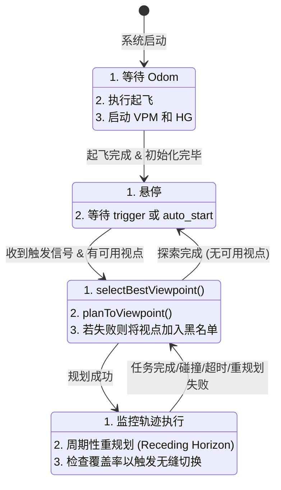

# 新版探索状态机（ExplorationFSMNew）设计详解

本文档详细解析 `exploration_fsm_new.cpp` 中实现的四状态探索状态机，旨在阐明其架构设计、状态转移逻辑、核心算法，并深入分析其中存在的一些潜在问题，特别是关于轨迹生成与更新的复杂性。

---

## 1. 总体设计与架构

新版 FSM 抛弃了旧版复杂的多状态设计，简化为一个高度集成的四状态模型。其核心设计思想是：

- **高频决策与低频维护分离**：FSM 以高频率（100Hz）运行，负责快速的执行监控和状态转移。而计算密集型任务，如视点生成（5Hz）和历史图更新（2Hz），则由独立的定时器在较低频率下执行。
- **状态功能高度内聚**：每个状态只负责一项核心任务（初始化、等待、规划、执行），逻辑清晰。
- **集成规划器**：路径规划（`EGOPlannerManager`）被直接封装在 FSM 的状态逻辑中调用，而不是作为一个独立的状态，简化了 FSM 的结构。

### 1.1 模块交互图

```mermaid
flowchart LR
    subgraph FSM_Core [ExplorationFSMNew]
        direction LR
        FSM_Timer[fsmCallback (100Hz)]
        Exec_Timer[executionCallback (100Hz)]
    end

    subgraph External_Modules
        VPM[ViewpointManager]
        HG[HistoryGraph]
        Planner[EGOPlannerManager]
        Odom[Odometry Subscriber]
    end

    FSM_Timer -->|调用| Planner
    FSM_Timer -->|读取| VPM
    FSM_Timer -->|读/写| HG
    Exec_Timer -->|发布| PosCmd[PositionCommand]
    Odom -->|更新| FSM_Core
```

- **`fsmCallback` (100Hz)**：FSM 的“大脑”，根据当前状态执行相应的 `process` 函数，负责状态转移、调用规划、检查执行条件等。
- **`executionCallback` (100Hz)**：FSM 的“小脑”，独立于主 FSM 逻辑，专门负责**轨迹的插值与发布**。只有在 `has_trajectory_` 为 `true` 时才工作。

---

## 2. 状态机流程图 (Mermaid)



---

## 3. 核心状态详解

### 3.1 `INIT` 状态
- **目标**：完成系统自举，安全起飞到指定高度。
- **流程**：
  1.  **等待 Odometry**：`have_odom_` 标志位为 `false` 时，持续等待里程计回调。
  2.  **执行起飞**：收到 odom 后，通过 `publishTakeoffCmd` 发布一个平滑的、时间控制的上升轨迹，直到达到 `config_.takeoff_height`。
  3.  **启动模块**：起飞完成后，调用 `history_graph_->start()` 和 `viewpoint_manager_->start()` 启动后台的定时器。
  4.  **状态转移**：完成所有初始化后，转移到 `WAIT_TRIGGER`。

### 3.2 `WAIT_TRIGGER` 状态
- **目标**：在空中稳定悬停，等待探索开始的指令。
- **流程**：
  1.  **悬停**：持续调用 `publishHoverCmd` 发布悬停指令。
  2.  **等待触发**：`triggered_` 标志位可通过两种方式置为 `true`：
      - 订阅 `/move_base_simple/goal` 话题。
      - `auto_start` 参数设为 `true`。
  3.  **检查视点**：触发后，检查 `viewpoint_manager_->hasValidViewpoints()`。
  4.  **状态转移**：若有可用视点，则转移到 `LOCALPLAN`。

### 3.3 `LOCALPLAN` 状态
- **目标**：从众多候选视点中选出最优的一个，并规划出一条可执行的轨迹。
- **流程**：
  1.  **选择视点 (`selectBestViewpoint`)**：
      - 从 `HistoryGraph` 获取所有有效视点。
      - 运行 Dijkstra 算法预计算从当前位置（或最近的 HNode）到所有目标 HNode 的路径成本。
      - 综合考虑**路径成本**和**视点分数**（`score`），选出代价最低的视点。
      - **黑名单机制**：会跳过 `blacklisted_clusters_` 中的视点。
  2.  **规划路径 (`planToViewpoint`)**：
      - 获取目标视点的位姿。
      - 构建一个**全局路径**（`global_path`），可能包含历史节点作为中间点。
      - 将全局路径转换为一个**航点队列**（`waypoint_queue_`）。
      - 调用 `planNextWaypoint` -> `planTrajectory` -> `planner_manager_->reboundReplan()` 来生成第一段轨迹。
  3.  **处理结果**：
      - **成功**：设置 `has_trajectory_ = true`，清空黑名单，重置计时器，转移到 `EXEC_EXPLORATION`。
      - **失败**：将该视点加入黑名单，保持在 `LOCALPLAN` 状态，下一帧会重新选点。

### 3.4 `EXEC_EXPLORATION` 状态
- **目标**：监控当前轨迹的执行情况，处理各种异常并触发重规划。
- **注意**：该状态**不直接发布**轨迹指令，实际的指令发布由 `executionCallback` 完成。
- **监控逻辑**：
  1.  **碰撞检测**：`checkCollision()` 会检查轨迹前方 `collision_lookahead` 时间内的路径是否安全。如果检测到碰撞，立即中止并返回 `LOCALPLAN`。
  2.  **到达航点**：`checkReachWaypoint()` 检查是否到达当前航点。如果是最终视点，则任务完成，返回 `LOCALPLAN`；如果是中间航点，则调用 `planNextWaypoint` 规划下一段路径。
  3.  **执行超时**：`checkTimeout()` 检查轨迹执行时间是否超过动态阈值（`traj_duration_ + 5s`）。超时则认为规划器可能卡死或目标不可达，返回 `LOCALPLAN`。
  4.  **覆盖率检测**：`checkCurrentGoalCovered()` 检查当前目标视点周围的未知区域是否已大部分被探索。如果是，则尝试通过 `triggerSeamlessReplan()` **无缝切换**到下一个更有价值的目标。
  5.  **周期性重规划**：为了应对动态环境，FSM 会以 `replan_check_interval` 的频率，在飞向同一目标的过程中不断重新规划路径。

---

## 4. 轨迹执行与更新机制的深入分析

这是 FSM 中最复杂、也最容易出问题的部分。核心在于 `executionCallback` 和 `planTrajectory` 之间的交互，以及多个标志位（`has_trajectory_`, `has_prev_traj_`, `use_replan_start_`）的协同工作。

### 4.1 `executionCallback` 的工作原理

这个函数在 100Hz 下独立运行，只做一件事：根据当前时间和轨迹数据，计算并发布 `PositionCommand`。

- **输入**：`ros::Time::now()`、`traj_start_time_`、`traj_duration_`、`planner_manager_->traj_`。
- **核心逻辑**：
  1.  计算 `t_cur = now - traj_start_time_`。
  2.  **如果 `t_cur < 0`**：这说明新轨迹的起始时间在未来（这是为无缝拼接设计的）。此时，如果 `has_prev_traj_` 为 `true`，则继续执行**上一段旧轨迹**，直到新轨迹的起始时间到来。
  3.  **如果 `0 <= t_cur <= traj_duration_`**：正常执行当前轨迹，从 `planner_manager_->traj_` 中插值出 pos/vel/acc。
  4.  **如果 `t_cur > traj_duration_`**：轨迹已执行完毕，保持在终点位置悬停。

### 4.2 无缝重规划（Seamless Replanning）的实现

当 `checkCurrentGoalCovered()` 发现当前目标已无价值时，会触发 `triggerSeamlessReplan()`。

- **流程**：
  1.  **预测未来状态**：在当前轨迹上预测 `0.1s` 后的无人机状态（pos, vel, acc），作为新轨迹的**显式起点**。
  2.  **设置标志位**：设置 `use_replan_start_ = true`，并将预测的起点和起始时间存入 `replan_start_*` 变量。
  3.  **重新选点规划**：立即调用 `selectBestViewpoint()` 和 `planToViewpoint()`。
  4.  **规划器使用新起点**：`planToViewpoint` -> `planTrajectory` 会检测到 `use_replan_start_` 为 `true`，从而将 `replan_start_*` 作为规划起点，而不是当前的 odom。
  5.  **轨迹拼接**：
      - `planTrajectory` 会将当前的轨迹保存为 `prev_traj_`，并设置 `has_prev_traj_ = true`。
      - 新规划出的轨迹 `start_time` 将是未来的 `replan_start_time_`。
      - `executionCallback` 在 `t_cur < 0` 的阶段会自动执行 `prev_traj_`，实现了平滑拼接。

---

## 5. 潜在问题与改进建议

### 5.1 问题：轨迹变量管理过于复杂且脆弱

- **问题描述**：
  - FSM 使用了 `has_trajectory_`, `has_prev_traj_`, `use_replan_start_`, `traj_start_time_`, `prev_traj_start_time_`, `replan_start_time_`, `last_pos_`, `prev_traj_` 等大量状态变量来管理轨迹的生命周期和拼接。
  - 这些变量的**重置和更新**分散在 `LOCALPLAN`, `EXEC_EXPLORATION`, `planTrajectory`, `triggerSeamlessReplan` 等多个函数中。
  - **任何一个标志位或时间戳在某个状态转移中未能被正确重置，都可能导致 `executionCallback` 行为异常**。例如，如果 `use_replan_start_` 在一次失败的重规划后没有被设回 `false`，下一次正常规划可能会错误地使用一个过期的起点。

- **改进建议**：
  - **状态封装**：将所有与当前轨迹和上一段轨迹相关的变量（轨迹对象、起止时间、标志位）封装到一个或两个 `struct` 中，例如 `TrajectoryState` 和 `PreviousTrajectoryState`。`planTrajectory` 函数的职责应该是返回一个新的 `TrajectoryState`，而不是修改一堆成员变量。
  - **原子化更新**：状态转移时，对轨迹状态的更新应该是原子化的。例如，当一次重规划成功后，用新的轨迹状态**完整替换**旧的状态，而不是零散地修改各个成员变量。

### 5.2 问题：`calculate_yaw` 的逻辑与 FSM 状态耦合

- **问题描述**：
  - `calculate_yaw` 函数负责计算每一帧的期望偏航角，它内部实现了一个“飞-看-转”的逻辑：轨迹前 70% 跟随速度方向，后 30% 平滑过渡到目标 `end_yaw_`。
  - `end_yaw_` 这个变量是在 `planTrajectory` 中被设置的，但 `calculate_yaw` 在 `executionCallback` 中被调用。这意味着 `calculate_yaw` 的行为隐式地依赖于上一次规划设置的状态。
  - 在复杂的重规划和拼接场景下，`end_yaw_` 是否总是指向**当前最新轨迹**的最终目标偏航角，是存在疑问的。如果 `end_yaw_` 未被及时更新，可能会导致无人机朝向一个过期的目标。

- **改进建议**：
  - 将 `end_yaw_` 也作为轨迹状态的一部分。每次 `planTrajectory` 成功后，将目标偏航角与轨迹本身绑定在一起。`executionCallback` 在执行时，应该从**当前正在执行的轨迹段**所关联的状态中获取其对应的 `end_yaw_`。

### 5.3 问题：黑名单机制可能导致“假死”

- **问题描述**：
  - 在 `LOCALPLAN` 状态，如果 `planToViewpoint` 失败，会将 `selected_vp_id` 加入 `blacklisted_clusters_`。
  - 如果所有可达的视点都因规划失败而被加入黑名单，`selectBestViewpoint` 将返回 `false`。
  - 此时，FSM 会检查 `viewpoint_manager_->hasValidViewpoints()`。如果 VP 管理器仍然认为存在视点（即使它们都不可达），FSM 就会卡在 `LOCALPLAN` 状态，不断打印 `No reachable viewpoint found, retrying...`。
  - 只有当所有视点都被加入黑名单后，代码才会尝试清空黑名单，但这中间可能已经浪费了大量时间。

- **改进建议**：
  - 引入一个**带超时的黑名单**：被加入黑名单的视点在一段时间后（例如 10-20 秒）自动移除。
  - 或者，当发现**连续 N 次**规划失败时，主动清空黑名单，而不是等到所有视点都被尝试一遍。

### 5.4 问题：`selectBestViewpoint` 的代价函数过于简化

- **问题描述**：
  - `evaluateViewpointCost` 中，对于近距离视点，它会尝试 A*。但对于远距离视点，它依赖 `DijkstraResult` 的缓存，并只计算了从 anchor node 到视点的 exit path 代价。
  - `selectBestViewpoint` 的主循环中，对不同 anchor node 的评估只更新了 `min_path_cost`，但没有把从 `curr_pos` 到 `start_node` 的代价也加进去。
  - 这可能导致它选择一个**拓扑距离很远**但**局部出口路径很短**的视点。

- **改进建议**：
  - 代价函数应更完整地反映总成本：`Cost = Cost(curr_pos -> start_node) + Cost(start_node -> anchor_node) + Cost(anchor_node -> vp_pos)`。
  - 其中 `Cost(start_node -> anchor_node)` 可以直接从 Dijkstra 缓存中获取。
  - `Cost(curr_pos -> start_node)` 也应该通过 A* 或射线检测来估算。
